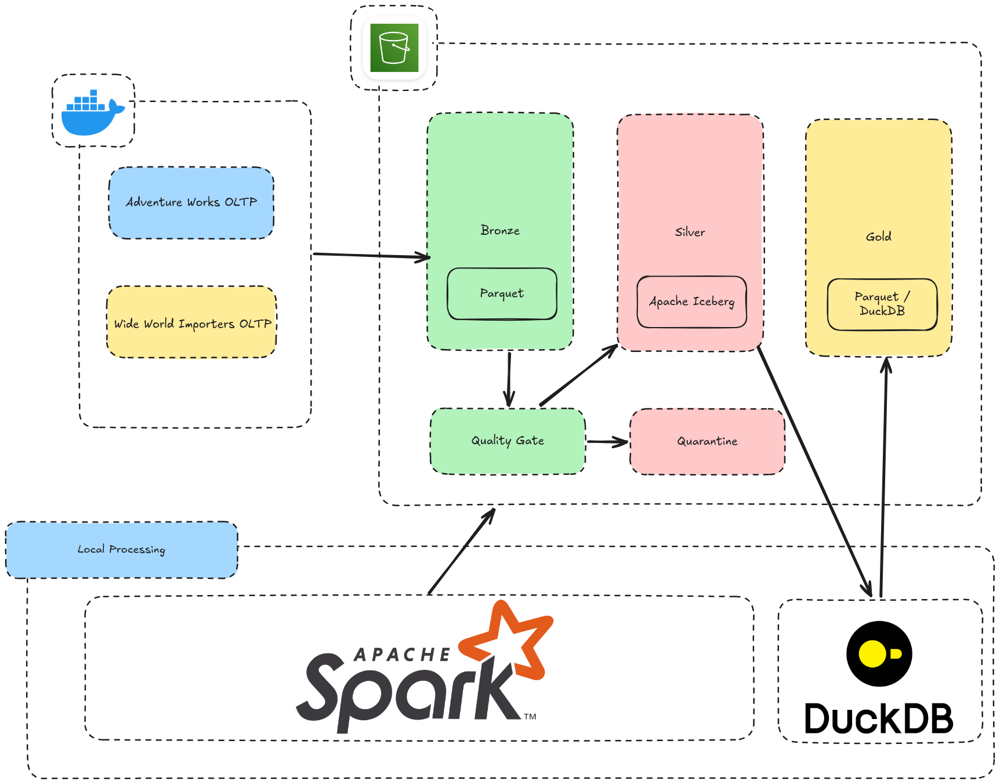

# Lakehouse Híbrido: Integração AdventureWorks & Wide World Importers

Pipeline de Engenharia de Dados de ponta a ponta que simula a fusão de dados transacionais (OLTP) de duas empresas distintas (**AdventureWorks** e **Wide World Importers**) em uma arquitetura **Medalhão (Bronze, Silver, Gold)** sobre **Amazon S3**, utilizando **PySpark**, **Apache Iceberg** e **DuckDB**.

O projeto foi desenhado aplicando os princípios de engenharia de sistemas de dados e observabilidade das obras de referência da O'Reilly:
* ***Designing Data-Intensive Applications*** (Martin Kleppmann)
* ***Data Quality Fundamentals*** (Barr Moses, Lior Gavish & Molly Vorwerck)

---

## Arquitetura da Solução



### Fluxo de Dados
1. **Fontes OLTP (Docker):** Instância SQL Server 2025 rodando localmente via Docker Compose hospedando os bancos relacionais *AdventureWorks* e *Wide World Importers*.
2. **Camada Bronze (Amazon S3 - Parquet):** Extração *full dump* dinâmica via PySpark (JDBC), com tratamento automático de tipos espaciais (`geography`, `geometry`, `hierarchyid`) e injeção de metadados de linhagem.
3. **Quality Gate & Quarentena (PySpark):** Validação automatizada de volume, completude e regras de negócio antes da promoção para a Silver. Registros anômalos são desviados para a camada de quarentena (`s3://.../quarantine/`) com rastreabilidade do erro.
4. **Camada Silver (Amazon S3 - Apache Iceberg):** Unificação de esquemas incompatíveis entre as duas empresas, criação de chaves substitutas determinísticas (`AW-` / `WWI-`), deduplicação idempotente e armazenamento em tabelas transacionais **Apache Iceberg**.
5. **Camada Gold (DuckDB + Amazon S3):** Processamento analítico OLAP via **DuckDB** lendo metadados Iceberg direto do S3 para construir um **Star Schema** (`dim_clientes`, `dim_produtos`, `dim_tempo`, `fato_vendas`) e uma **One Big Table (`obt_vendas_ml`)** pronta para consumo de BI e Machine Learning.

---

## Fundamentação Teórica Aplicada (O'Reilly)

### 1. *Designing Data-Intensive Applications* (Martin Kleppmann)
* **Desacoplamento OLTP vs. OLAP:** Replicação dos dados transacionais para armazenamento colunar (**Parquet** e **Iceberg**), evitando impacto de consultas analíticas pesadas nos bancos operacionais.
* **Idempotência e Determinismo:** Uso de chaves compostas baseadas na origem (`AW-101`, `WWI-101`) e deduplicação (`dropDuplicates`) para evitar colisão de IDs entre empresas e garantir que reprocessamentos produzam exatamente o mesmo estado final.
* **Evolução de Esquema e Tabelas Abertas:** Adoção do **Apache Iceberg** na camada Silver para suportar transações ACID, isolamento de leitura/escrita e futura evolução de esquema sem reescrever todo o Data Lake.

### 2. *Data Quality Fundamentals* (Barr Moses et al.)
* **Linhagem de Dados (Data Lineage):** Toda tabela ingerida na Bronze recebe colunas de auditoria (`_source_system`, `_source_table`, `_ingestion_timestamp`), permitindo rastrear a origem exata de qualquer registro.
* **Disjuntores (Circuit Breakers):** O módulo `src/quality/checks.py` interrompe o pipeline (`ValueError`) caso o volume extraído fique abaixo do limite mínimo esperado, impedindo que falhas de extração sobrescrevam dados válidos na Silver.
* **Isolamento em Quarentena (Quarantine Pattern):** Em vez de descartar silenciosamente dados corrompidos ou quebrar o job inteiro por registros pontuais, linhas que falham nas regras de nulidade ou valores negativos são isoladas no S3 com a coluna `_dq_errors` detalhando o motivo da rejeição.

---

## Estrutura do Projeto

```text
projeto-lakehouse-aw-wwi/
├── docs/                        # Diagramas de arquitetura
├── src/
│   ├── spark_session.py         # Factory da SparkSession (S3A, JDBC e Catálogo Iceberg)
│   ├── bronze/
│   │   └── ingest_oltp.py       # Descoberta dinâmica de tabelas e extração OLTP -> S3 Parquet
│   ├── quality/
│   │   └── checks.py            # Motor de Data Quality, Circuit Breaker e Quarentena
│   ├── silver/
│   │   └── transform_silver.py  # Unificação de esquemas e escrita em Apache Iceberg
│   └── gold/
│       └── build_gold.py        # Modelagem Star Schema e OBT ML via DuckDB -> S3 Gold
├── docker-compose.yml           # Infraestrutura local SQL Server
├── requirements.txt             # Dependências Python
├── .env.example                 # Template de variáveis de ambiente
└── .gitignore                   # Proteção de credenciais e arquivos locais
```

---

## Como Executar o Projeto

### Pré-requisitos
* Linux / WSL2 com **Docker** e **Docker Compose**
* **Python 3.10+** e **Java JDK 11 ou 17**
* Conta AWS com um bucket S3 e usuário IAM com permissões restritas ao bucket (princípio do privilégio mínimo)

### Passo a Passo

1. **Clone o repositório e configure o ambiente virtual:**
   ```bash
   git clone https://github.com
   cd projeto-lakehouse-aw-wwi
   python3 -m venv .venv
   source .venv/bin/activate
   pip install -r requirements.txt
   ```

2. **Configure as variáveis de ambiente:**
   Crie um arquivo `.env` na raiz baseado no `.env.example` e preencha suas credenciais AWS e senha do banco local.

3. **Suba o banco de dados e restaure os backups:**
   Coloque os arquivos `AdventureWorks2022.bak` e `WideWorldImporters-Full.bak` na pasta `backups/` e inicie o container:
   ```bash
   docker compose up -d
   ```
   *(Execute os scripts de `RESTORE DATABASE` via DBeaver ou `sqlcmd` na porta `1434`).*

4. **Execute o pipeline Medalhão em sequência:**
   ```bash
   # 1. Ingestão Bronze (SQL Server -> S3 Parquet)
   python -m src.bronze.ingest_oltp

   # 2. Processamento Silver + Data Quality (S3 Bronze -> S3 Iceberg + Quarantine)
   python -m src.silver.transform_silver

   # 3. Camada Gold Analítica (S3 Iceberg -> DuckDB + S3 Gold Parquet)
   python -m src.gold.build_gold
   ```

---

## Próximos Passos (Roadmap)
* [ ] **Data Warehouse Cloud:** Conectar um *External Stage* no **Snowflake** apontando para a camada Gold/Silver no S3 para serving corporativo.
* [ ] **Orquestração:** Automatizar a execução das etapas Bronze -> Silver -> Gold via **Apache Airflow**.
* [ ] **Machine Learning & Estatística:** Consumir a tabela `gold_obt_vendas_ml.parquet` diretamente do S3 em um repositório dedicado para previsão de demanda e análise estatística de vendas.

